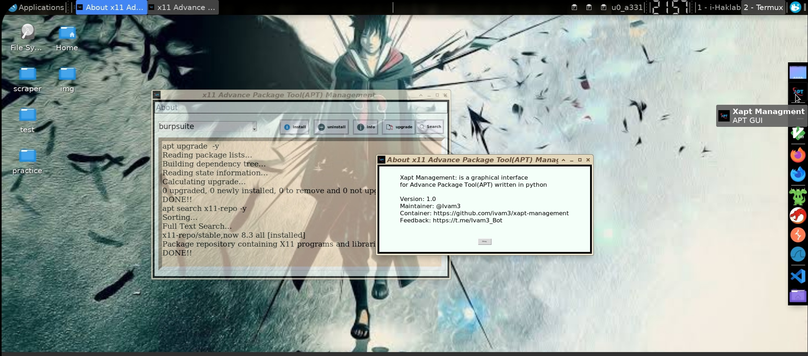

# Xapt

> A Tkinter graphical frontend for the Advanced Package Tool (APT) on Termux.

Xapt makes common APT operations available from the Termux:X11 desktop: browse
packages, read their metadata, install, remove, purge, upgrade, hold and clean
the cache. It is intentionally GUI-only; the `apt` command remains the
authoritative command-line interface.



## Why Xapt

APT is powerful, but its output can be difficult to read on a small display and
destructive operations are easy to mistype. Xapt adds a package list, a search
box, a details pane and explicit confirmation for destructive actions while
calling the same `apt` commands underneath.

## Features

- Search and filter the package index (all, installed, upgradable).
- Package details, dependencies and installed file list in separate tabs.
- Install, remove, purge, hold and unhold the selected package.
- Update the APT index, upgrade all packages, autoremove and clean the cache.
- Stream APT output to an in-app log with success and error highlighting.
- Cancel a running operation.
- Threaded operations, so the interface stays responsive.
- Tkinter `ttk` widgets, selectable themes and responsive layout.
- Optional icon set shared with the desktop launcher.

## Requirements

- Termux with `x11-repo`
- `python` and `python-tkinter`
- A working X server, such as Termux:X11 or Xwayland
- An X desktop environment (Xfce, Fluxbox, Openbox, LXQt, MATE, bspwm, etc.)

Tkinter is used instead of GTK because the installed footprint is much smaller
on Termux: Tkinter plus Tk is roughly 8 MB, while GTK4, libadwaita and PyGObject
add tens of megabytes. Xapt does not need a compositor or a GTK theme engine.

## Installation

### Termux package (recommended)

Add the i-HakLab APT repository:

```bash
pkg install gnupg
mkdir -p "$PREFIX/etc/apt/sources.list.d"
curl -fsSL https://raw.githubusercontent.com/ivam3/termux-packages/gh-pages/ivam3-termux-packages.list \
  -o "$PREFIX/etc/apt/sources.list.d/ivam3-termux-packages.list"
curl -fsSL https://raw.githubusercontent.com/ivam3/termux-packages/gh-pages/docs/dists/stable/public_key.gpg \
  | gpg --dearmor > "$PREFIX/etc/apt/trusted.gpg.d/ivam3.gpg"
pkg update
pkg install xapt-management
```

Launch it from the desktop menu or a terminal:

```bash
xapt
```

### Run from source

```bash
git clone https://github.com/ivam3/xapt-management.git
cd xapt-management
python -m pip install -r requirements.txt
python main.py
```

The source tree expects the screenshots and icons in `.deb/img/`. The packaged
launcher copies them to `img/` during installation.

## Usage

1. Launch `xapt`.
2. Type in **Search** to filter by package name or summary.
3. Select **Installed** or **Upgradable** to narrow the list.
4. Select a package to load its details, dependencies and files.
5. Use the action buttons:
   - **Install** installs the selected package.
   - **Remove** removes the package but keeps configuration files.
   - **Purge** removes the package and its configuration files.
   - **Update** refreshes the APT package index.
   - **Upgrade** upgrades all installed packages.
   - **Autoremove** removes dependencies that are no longer needed.
   - **Clean** clears the APT package cache.
   - **Hold** / **Unhold** pins or unpins a package version.
   - **Cancel operation** stops the running APT process.
6. Read the live output in the **APT output** panel.

Keyboard shortcuts:

| Shortcut | Action |
|---|---|
| `Ctrl+F` | Focus the search box. |
| `F5` | Refresh the package index. |
| `Ctrl+Q` | Quit Xapt. |

## Architecture

```text
xapt-management/
├── main.py          # Tkinter interface and event loop
├── xapt_core.py     # APT process, parsing and package operations
├── requirements.txt # Runtime dependencies (none beyond the standard library)
├── .deb/
│   ├── manifiest.json
│   ├── postinst
│   ├── postrm
│   ├── preinst
│   ├── prerm
│   ├── xapt
│   ├── xapt-installer
│   ├── xapt.desktop
│   └── img/
└── README.md
```

`main.py` never builds shell strings. All commands are argument lists passed to
`xapt_core.AptService`, which centralizes cancellation, environment setup,
output capture and error handling.

## Development

Check the Python syntax:

```bash
python -m py_compile main.py xapt_core.py
```

Run the core logic against a disposable Termux environment:

```bash
python - <<'PY'
from xapt_core import AptService
service = AptService()
print(len(service.list_packages()), "packages")
print(service.details("bash").get("Description", "no description"))
PY
```

Do not run package-changing operations as part of a syntax test.

## Packaging

The `.deb/manifiest.json` file is consumed by the i-HakLab packaging pipeline.
The package installs two commands:

- `xapt`: launches `main.py` from
  `$PREFIX/share/applications/xapt`.
- `xapt-installer`: installs the application from the Git repository.

The package post-install script copies `.deb/img` to `img`, removes the
packaging-only directory, installs the Python requirements and refreshes the
desktop entry. Reinstalling over an existing clone is supported.

## Troubleshooting

### `xapt: command not found`

Make sure the repository is configured and install the package again:

```bash
pkg update
pkg install xapt-management
```

### `No module named tkinter`

```bash
pkg install python-tkinter
```

### The window does not open

Start Termux:X11 first and verify that `DISPLAY` is set:

```bash
echo "$DISPLAY"
xapt
```

### APT reports a lock

Another package manager is running. Close it or wait for it to finish. If the
lock is stale, reboot Termux and try again.

### An operation appears stuck

Use **Cancel operation** or press `Ctrl+C` in the terminal that launched Xapt.
The next operation starts with a clean APT process.

## License

GNU. See [LICENSE](LICENSE).

##### Follow me on [Socials Network](https://ivam3.github.io)
